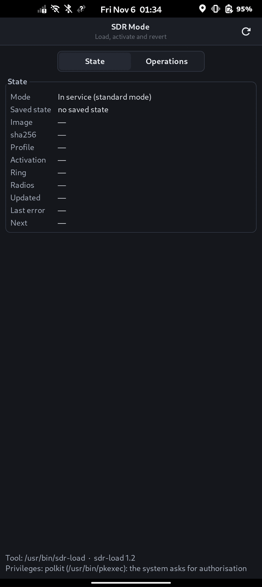
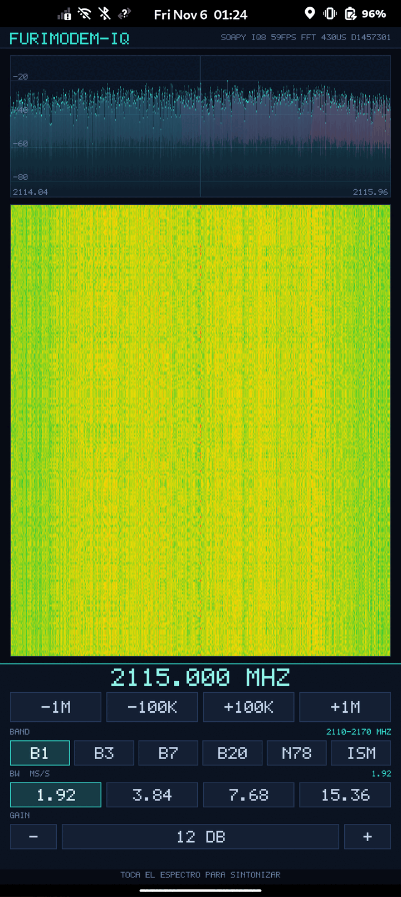

# furimodem IQ — modo SDR sobre el módem del teléfono

[English](README.md)

Convierte el módem del FuriPhone en un **receptor IQ** sin necesidad de célula: el firmware se
parchea **en binario** sobre la imagen del módem, se carga con una herramienta propia que sabe
revertirlo, y los datos se leen por SoapySDR desde una app con waterfall.

## Piezas

| ruta | qué es |
|---|---|
| `driver/` | módulo SoapySDR (`driver=furimodem_iq`): controles de sintonía, ancho y ganancia y lectura del anillo de IQ |
| `app/` | demo Wayland + EGL/GLES: waterfall, espectro y controles; fuentes sintética, fichero y dispositivo |
| `gui/` | ventana GTK3 para el teléfono: estado, carga, activación, descarga y restauración (salir del modo SDR); invoca `sdr-load` como subproceso |
| `tools/sdr-load.cpp` | cargador: comprueba precondiciones, aplica la imagen del modo SDR, **activa el modo** y revierte |
| `tools/make-iqfile.py` | genera ficheros de bloques IQ con un tono conocido, para probar sin teléfono |
| `tools/test-iq5file.sh` | ciclo completo de prueba en local: 5 bits, 8 bits, volcado ambiguo y CS16 |
| `tools/crossbuild2.sh` | compilación cruzada reproducible del paquete entero (base **Debian sid**, la del teléfono) |
| `tools/make-sdr-image.py` | construye la imagen del modo SDR desde **tu** imagen de stock; no se distribuye firmware |
| `docs/SDR-IMAGE.es.md` | la imagen: sha256 de stock, el parche, carga, activación y vuelta atrás |

Cada pieza tiene sus notas (en inglés): [driver](driver/README.md), [app](app/README.md),
[gui](gui/README.md), [tools](tools/README.md); [DEMO.md](DEMO.md) es un guion de demo de cinco
minutos.

## Puesta en marcha

Todo se compila en el portátil: el teléfono no tiene cmake.

### Qué necesitas

- **Teléfono**: un Furi Labs FLX1 con FuriOS (Debian sid/aarch64) y el **firmware E6 del módem**,
  SSH activado y acceso como `furios`, `sudo` y **ofono en marcha** (el barrido se dispara por
  `busctl`/`org.ofono`). Otra versión de firmware la rechaza la comprobación de imagen.
- **Portátil**: `docker` (la compilación cruzada descarga `debian:sid`), `python3`, `sha256sum`,
  `ssh`/`scp` y ~1 GB libre para la compilación y las imágenes.
- **SoapySDR en el teléfono** (`SoapySDRUtil --info` debe funcionar); el módulo se instala en
  `/usr/lib/aarch64-linux-gnu/SoapySDR/modules0.8/` (ajusta la ruta si tu sistema usa otra).
- **Una imagen de stock del módem**: se vuelca de tu propio teléfono en el paso 3, antes de
  escribir nada. Es tu camino de vuelta. Este repositorio no distribuye firmware.

```sh
# 1. compilación cruzada del paquete para el teléfono (módulo, app, ventana, cargador y anillo)
docker run --rm -v "$PWD":/src -v "$PWD/out":/out debian:sid sh /src/tools/crossbuild2.sh

# 2. instalación en el teléfono (Debian sid/aarch64; ajusta la ruta de SoapySDR si hace falta)
scp out/libfurimodemIQ.so out/fmiq-app out/furimodem-sdr out/sdr-load out/iqring_pull \
    app/fmiq-app.desktop app/fmiq-app-captura.desktop gui/furimodem-sdr.desktop \
    app/assets/icons/furimodem-iq.png gui/org.furimodem.sdr.policy furios@<movil>:/tmp/
ssh furios@<movil> '
  sudo install -m644 /tmp/libfurimodemIQ.so /usr/lib/aarch64-linux-gnu/SoapySDR/modules0.8/
  sudo install -m755 /tmp/fmiq-app /tmp/furimodem-sdr /tmp/sdr-load /tmp/iqring_pull /usr/bin/
  sudo install -m644 /tmp/fmiq-app.desktop /tmp/fmiq-app-captura.desktop \
       /tmp/furimodem-sdr.desktop /usr/share/applications/
  sudo install -m644 /tmp/furimodem-iq.png /usr/share/icons/hicolor/256x256/apps/
  sudo install -m644 /tmp/org.furimodem.sdr.policy /usr/share/polkit-1/actions/'

# 3. imagen del modo SDR, parcheada desde TU imagen de stock (no se distribuye firmware)
#    Hazlo ANTES de escribir nada: stock-modem.img es el único camino de vuelta. Guarda también
#    una copia fuera del teléfono.
ssh furios@<movil> 'sudo head -c 63018064 /dev/disk/by-partlabel/md1img_a' > stock-modem.img
sha256sum stock-modem.img          # debe ser 22c1909dbf9f0455c1a93f8a8e0a141245cc9b2d979c44d0c8da75f5a3424896
python3 tools/make-sdr-image.py stock-modem.img      # -> modem-sdr-8bit.img (5a625327...)
scp stock-modem.img furios@<movil>:/home/furios/modem-E6.img   # copia de rescate para --restore
scp modem-sdr-8bit.img tools/flash_modem.sh furios@<movil>:/home/furios/
ssh furios@<movil> chmod +x /home/furios/flash_modem.sh

# 4. modo SDR (ejecuta esto en el movil: ssh furios@<movil>)
sudo sdr-load --image /home/furios/modem-sdr-8bit.img   # escribe y verifica; no reinicia
sudo systemctl reboot                                   # el bootloader lee la imagen nueva
sudo sdr-load --resume                                  # tras el arranque: entra y activa
sudo sdr-load --status                                  # imagen, perfil y latido del anillo
#    ... y para volver:
sudo sdr-load --deactivate                              # para el barrido
sudo sdr-load --image /home/furios/modem-E6.img         # imagen de stock otra vez
sudo systemctl reboot                                   # el bootloader la lee al arrancar
```

> **Antes de ejecutar `--image`:** desactiva WiFi y Bluetooth con `rfkill` a propósito, *antes* de
> escribir. Si tu SSH va por la WiFi del teléfono, la sesión se corta antes de la escritura: usa la
> dirección USB/RNDIS o ejecútalo desde un terminal del teléfono. Un `--image` correcto sale con
> **código 6** (imagen escrita y verificada, hace falta reiniciar); no es un fallo.

### Qué debe salir

- `sudo sdr-load --status` muestra la imagen `sdr-8bit`, el modo activo y una línea `next` que no
  pide otro reinicio; el módem vuelve a estar `ready`.
- Con el barrido en marcha, `fmiq-app --headless 60 --source soapy --out /tmp/demo.ppm` imprime
  `variety=yes`: cada fila del waterfall es distinta, así que hay I/Q real moviéndose por el anillo.
- La ventana (`fmiq-app`) pinta un waterfall que se mueve mientras el teléfono barre.

Si no funciona: el **código 6** después de `--image` es éxito (hace falta reiniciar); los códigos 5/13 de `--image` significan que la partición no tiene la imagen que la
herramienta conoce (comprueba el sha256 de stock y vuelve a generarla); el código 8 significa que el
módem aún no ha terminado de entrar en el modo (espera y reintenta; la herramienta sondea hasta 20
s); un `md1` en `exception` se recupera escribiendo otra vez la imagen de stock y reiniciando. No
interrumpas `AT+COPS=?`.

`sdr-load --image` escribe la partición, verifica la relectura y deja `pending=reboot-to-enter`; el
cargador solo la lee al arrancar, así que **reinicia antes de `--resume`** (`--reboot` hace que lo
haga la herramienta). La imagen se resuelve por sha256 contra la tabla: `sdr-8bit` es la imagen de
barrido, 8 bits por componente, origen 3 y **sintonía fija en 2.115,0 MHz** (banda 1);
`standard-a` y `standard-b` son imágenes de laboratorio y no se distribuyen. Una imagen que no esté
en la tabla se rechaza (código 5, o 13 si la partición no se puede identificar) y se listan las
conocidas; `--profile` añade una.

Con una **imagen de modo** (`standard-a`/`standard-b`) el módem sale de servicio; con la **imagen de
barrido** (`sdr-8bit`) sigue en servicio a propósito, porque su propio barrido de frecuencias es lo
que alimenta el anillo. `--activate` ejecuta los nueve pasos verificados en una imagen de modo y, en
`sdr-8bit`, lanza el barrido y comprueba que el anillo publique. `--deactivate` para el barrido.

**`--resume` es lo que termina el trabajo tras el reinicio.** Comprueba que la partición tiene la
imagen que el estado registró (sha256 y tamaño), cierra el pendiente y ejecuta la activación; la
partición **no** se vuelve a escribir. `--activate` es idempotente y hace lo mismo, así que una
activación a medias no se queda ahí. `--status` lo dice en su línea `next`.

Con la imagen cargada, la captura la dispara el **barrido de frecuencias del propio teléfono**:

```sh
sudo busctl --timeout=30 call org.ofono /ril_0 org.ofono.FuriLabs.AT SendCommand s "AT+CFUN=1"
sudo busctl --timeout=300 call org.ofono /ril_0 org.ofono.FuriLabs.AT SendCommand s "AT+COPS=?"
```

Sin barrido no hay datos: el receptor entrega ráfagas, no un flujo continuo.
No interrumpas `AT+COPS=?`: un barrido cortado deja el módem en `exception` y hay que
recuperarlo reflasheando la imagen y reiniciando.

La misma secuencia, desde phosh: `furimodem-sdr` (ver `gui/README.md`) muestra el estado y lanza
`sdr-load` como subproceso para cargar, activar, detener y restaurar (salir del modo SDR). Las operaciones que
necesitan root pasan por `pkexec`, de modo que el escritorio pide autorización en su propio
diálogo; sin pkexec, o si se cancela el diálogo, la ventana enseña la orden exacta con un botón
para copiarla. La ventana es oscura por sí misma, sea cual sea el tema del escritorio.

En el teléfono aparecen dos accesos: **Furimodem IQ** (dispositivo) y **Furimodem IQ (captura)**,
que abre un volcado guardado en `/var/lib/furimodem-iq/captura.iq`. Se crea en el teléfono con:

```sh
sudo install -d -o furios -g furios /var/lib/furimodem-iq
sudo iqring_pull 20 /var/lib/furimodem-iq/captura.iq
```

## Capturas




## Estado y límites (importante)

Lo que **hoy funciona**, medido en el teléfono: el waterfall pinta **I/Q real del módem** en la
pantalla, con el eje puesto en la frecuencia que trae cada bloque; durante un barrido se siguieron
**213 frecuencias distintas entre 763,0 y 2.685,0 MHz** en 50 s; y la captura en **8 bits por
componente** funciona con la toma de RF correcta (un CW de prueba aparece en el bin que le toca en
**9/9** capturas). El waterfall en vivo se probó con el formato de 5 bits; el de 8 bits, sobre
capturas ya volcadas y abiertas con el mismo lector y la misma app.

Los dos límites que condicionan el uso:

- **El camino de 8 bits es menos sensible.** Gana tres bits de resolución (18 dB de cuantización) y
  quita la atadura entre bits bajos del formato de 5 bits, pero llega del orden de **26 dB más
  débil** porque no pasa por el control automático de ganancia. Con el mismo tono: 38,1 dB
  pico/mediana en 5 bits frente a 11,7 dB en 8 bits. Es más resolución con menos nivel, no mejor
  relación señal/ruido. Igualar la ganancia de las dos tomas queda pendiente.
- **La frecuencia barre; no se sintoniza.** El receptor recorre su plan de barrido y cada bloque
  lleva en la cabecera la frecuencia de esa ráfaga, que es lo que la app pinta en el eje. Los
  controles de frecuencia de la interfaz **no mueven el oscilador**: la app envía la petición al
  módulo y la mantiene visible dos segundos, pero la cabecera vuelve a imponerse y un aviso ámbar
  indica que la sintonía la controla el perfil activado (o la cabecera de bloque, con un fichero).
  Forzar la etiqueta en la imagen sigue **etiquetando pero no sintonizando** (medido: con la
  etiqueta fija el tono desaparece). Para ver una banda concreta hay que esperar a que el barrido
  pase por ella. Detalles: [`app/README.md`](app/README.md).

Otros límites:

- **Sin barrido no hay flujo**: no hay captura continua ni grabación continua. Con el lazo de
  copia antiguo se midieron 13,5-15 volcados/s sostenidos (43/s con el lector corregido), del orden
  de 0,3-0,5 MS/s de muestras útiles; el anillo del buscador publica ~100 capturas/s durante el
  barrido.
- **La cuantización de 5 bits** sirve para detectar y situar una señal, no para demodular ni medir
  amplitud fina. La de 8 bits da tres bits más, con el límite de sensibilidad de arriba.
- El driver es **solo recepción**: un canal RX, sin camino de transmisión.
- Con una **imagen de modo** (`standard-a`/`standard-b`) el modo SDR **desactiva la radio del
  módem**: el servicio de telefonía no arranca porque no hay HAL de radio. Con la **imagen de
  barrido** (`sdr-8bit`) el módem sigue en servicio y el barrido es lo que produce las capturas. En
  ambos casos `--deactivate` para la captura y `--image <stock>` devuelve el teléfono a stock.

La imagen y su parche están descritos en [`docs/SDR-IMAGE.es.md`](docs/SDR-IMAGE.es.md)
([English](docs/SDR-IMAGE.md)).

## Uso de cada herramienta

```sh
# app: ventana en el teléfono, o análisis sin GPU
fmiq-app                                              # waterfall en vivo (Wayland + EGL)
fmiq-app --headless 60 --source soapy --out /tmp/demo.ppm   # sin ventana, fuente dispositivo
fmiq-app --headless 12 --fft 2048 --source file --file volcado.bin --check-bin 1280
fmiq-app --gpu-test 120 --fft 512 --size 480x1025 --source soapy --out frame.ppm

# ventana GTK3 del modo SDR: estado, carga, activación y restauración (salir del modo SDR)
furimodem-sdr

# volcar el anillo a un fichero y abrirlo luego en el portátil
sudo iqring_pull 20 /tmp/iqring.bin                    # en el teléfono (instalado en /usr/bin)
fmiq-app --headless 4 --source file --file /tmp/iqring.bin

# probes y pruebas del driver
SOAPY_SDR_PLUGIN_PATH=$PWD/driver/build SoapySDRUtil --probe=driver=furimodem_iq
sudo ./driver/build/selftest_transport --live /dev/ccci_ccb_meta 5
```

## Verificación

```sh
cmake -S driver -B driver/build && cmake --build driver/build   # la primera vez en un clon
(cd driver && ctest --test-dir build)   # lector del anillo, estado y transporte
(cd app && make test)                  # FFT, waterfall, plazo de arranque y pintado
(cd gui && make test)                  # lectura de estado, órdenes y códigos de salida
tools/test-iq5file.sh                  # 5 bits, 8 bits, volcado ambiguo y CS16, sin teléfono
```

No se distribuye ninguna imagen de firmware: `tools/make-sdr-image.py` aplica un parche de 1.694
bytes sobre la imagen de stock (sha256 `22c1909d…`) en tu máquina y comprueba que el resultado es la
imagen `sdr-8bit` (`5a625327…`). No se escribe nada hasta que ambos hashes coinciden; detalle en
`docs/SDR-IMAGE.es.md`.

## Cómo se desarrolló

El mecanismo se encontró probando cerca de **200 imágenes de firmware modificadas**; el resultado se
entrega como [`tools/make-sdr-image.py`](tools/make-sdr-image.py), un parche binario de 1,7 kB que se
aplica a la imagen de stock del usuario, nunca como una imagen de firmware redistribuida.

## Licencia

Este proyecto se distribuye bajo la **GNU General Public License v3.0** (GPLv3).
El texto completo está en [`LICENSE`](LICENSE).

Copyright (C) 2026 los autores de furimodem-sdr.
