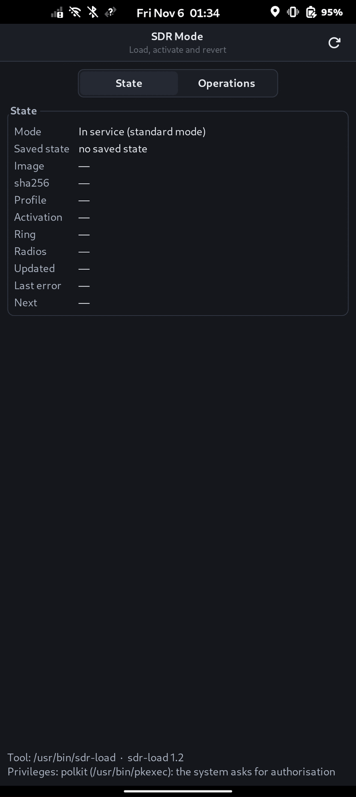
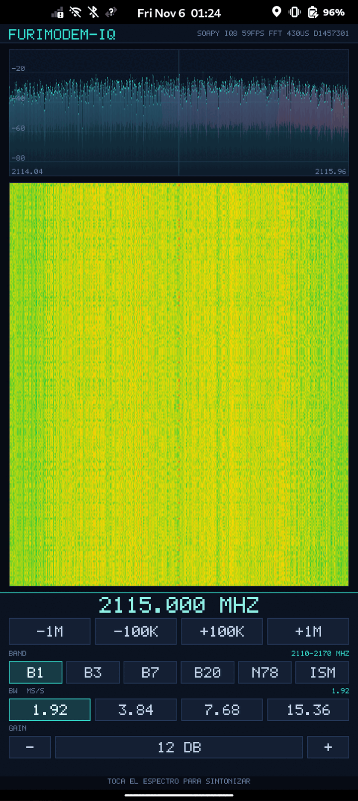

# furimodem IQ — SDR mode on the phone's modem

Turns the FuriPhone modem into an **IQ receiver** without a cell: the receiver is enabled with a
**binary patch** applied by a dedicated tool that knows how to revert it, and the data is read over
SoapySDR from an app with a waterfall.

## Components

| path | what it is |
|---|---|
| `driver/` | SoapySDR module (`driver=furimodem_iq`): tuning, width and gain controls and IQ ring reads |
| `app/` | Wayland + EGL/GLES demo: waterfall, spectrum and controls; synthetic, file and device sources |
| `gui/` | GTK3 window for the phone: status, load, activation, unload and restore (leave SDR mode); invokes `sdr-load` as a subprocess |
| `tools/sdr-load.cpp` | loader: checks preconditions, applies the SDR-mode image, **activates the mode** and reverts |
| `tools/make-iqfile.py` | generates IQ block files with a known tone, for testing without the phone |
| `tools/test-iq5file.sh` | full local test cycle: 5-bit, 8-bit, ambiguous dump and CS16 |
| `tools/crossbuild2.sh` | reproducible cross-build of the whole package (base **Debian sid**, the phone's) |
| `tools/make-sdr-image.py` | builds the SDR-mode image from **your own** stock image; no firmware is distributed |
| `docs/SDR-IMAGE.md` | the image: stock sha256, the patch, load, activation and revert |

## Getting started

Everything is built on the laptop: the phone has no cmake.

```sh
# 1. Cross-build the package for the phone (module, app, window, loader and ring tool)
docker run --rm -v "$PWD":/src -v "$PWD/out":/out debian:sid sh /src/tools/crossbuild2.sh

# 2. Install it on the phone (Debian sid/aarch64; adjust the SoapySDR path if needed)
scp out/libfurimodemIQ.so out/fmiq-app out/furimodem-sdr out/sdr-load out/iqring_pull \
    app/fmiq-app.desktop app/fmiq-app-captura.desktop gui/furimodem-sdr.desktop \
    app/assets/icons/furimodem-iq.png gui/org.furimodem.sdr.policy furios@<phone>:/tmp/
ssh furios@<phone> '
  sudo install -m644 /tmp/libfurimodemIQ.so /usr/lib/aarch64-linux-gnu/SoapySDR/modules0.8/
  sudo install -m755 /tmp/fmiq-app /tmp/furimodem-sdr /tmp/sdr-load /tmp/iqring_pull /usr/bin/
  sudo install -m644 /tmp/fmiq-app.desktop /tmp/fmiq-app-captura.desktop \
       /tmp/furimodem-sdr.desktop /usr/share/applications/
  sudo install -m644 /tmp/furimodem-iq.png /usr/share/icons/hicolor/256x256/apps/
  sudo install -m644 /tmp/org.furimodem.sdr.policy /usr/share/polkit-1/actions/'

# 3. The SDR-mode image, patched from YOUR stock image (no firmware is distributed).
#    Dump the stock image from the phone and check its sha256 first.
ssh furios@<phone> 'sudo head -c 63018064 /dev/disk/by-partlabel/md1img_a' > stock-modem.img
sha256sum stock-modem.img          # must be 22c1909dbf9f0455c1a93f8a8e0a141245cc9b2d979c44d0c8da75f5a3424896
python3 tools/make-sdr-image.py stock-modem.img      # -> modem-sdr-8bit.img (5a625327...)
scp stock-modem.img furios@<phone>:/home/furios/modem-E6.img   # rescue copy for --restore
scp modem-sdr-8bit.img tools/flash_modem.sh furios@<phone>:/home/furios/
ssh furios@<phone> chmod +x /home/furios/flash_modem.sh

# 4. SDR mode (run these on the phone: ssh furios@<phone>)
sudo sdr-load --image /home/furios/modem-sdr-8bit.img   # writes and verifies; it does not reboot
sudo systemctl reboot                                   # the bootloader reads the new image
sudo sdr-load --resume                                  # after the boot: enters the mode and activates
sudo sdr-load --status                                  # image, profile and ring heartbeat
#    ... and to go back:
sudo sdr-load --deactivate                              # stops the sweep
sudo sdr-load --image /home/furios/modem-E6.img         # stock image again
sudo systemctl reboot                                   # the bootloader reads it
```

`sdr-load --image` writes the partition, verifies the read-back and leaves
`pending=reboot-to-enter`; the loader only reads it at boot, so **reboot before `--resume`**
(`--reboot` makes the tool do it). The image is resolved by sha256 against the profile table:
`sdr-8bit` is the sweep image, 8 bits per component, origin 3 and **fixed tuning at 2,115.0 MHz**
(band 1); `standard-a` and `standard-b` are laboratory images and are not distributed. An image
that is not in the table is refused (code 5, or 13 if the partition cannot be identified) and the
known ones are listed; `--profile` adds one.

With a **mode image** (`standard-a`/`standard-b`) the modem leaves service; with the **sweep
image** (`sdr-8bit`) it stays in service on purpose, because its own frequency scan is what feeds
the ring. `--activate` runs the nine verified steps for a mode image and, for `sdr-8bit`, launches
the scan and checks that the ring publishes. `--deactivate` stops the sweep.

**`--resume` is what finishes the job after the reboot.** It checks that the partition holds the
image the state recorded (sha256 and size), closes the pending flag and runs the activation; the
partition is **not** written again. `--activate` is idempotent and does the same, so a half-done
activation is never left there. `--status` says it in its `next` line.

With the image loaded, capture is triggered by the **phone's own frequency sweep**:

```sh
sudo busctl --timeout=30 call org.ofono /ril_0 org.ofono.FuriLabs.AT SendCommand s "AT+CFUN=1"
sudo busctl --timeout=300 call org.ofono /ril_0 org.ofono.FuriLabs.AT SendCommand s "AT+COPS=?"
```

Without a sweep there is no data: the receiver delivers bursts, not a continuous stream.
Do not interrupt `AT+COPS=?`: an interrupted scan leaves the modem in `exception` and it has to
be recovered by flashing the image again and rebooting.

The same sequence, from phosh: `furimodem-sdr` (see `gui/README.md`) shows the status and launches
`sdr-load` as a subprocess to load, activate, stop and restore factory settings. The operations
that need root go through `pkexec`, so the desktop asks for authorisation in its own dialogue;
without pkexec, or if the dialogue is cancelled, the window shows the exact command with a button
to copy it. The window is dark on its own, whatever the desktop theme is.

Two launchers appear on the phone: **Furimodem IQ** (device) and **Furimodem IQ (capture)**,
which opens a dump saved at `/var/lib/furimodem-iq/captura.iq`. Create it on the phone with:

```sh
sudo install -d -o furios -g furios /var/lib/furimodem-iq
sudo iqring_pull 20 /var/lib/furimodem-iq/captura.iq
```

## Screenshots




## Status and limits (important)

What **works today**, measured on the phone: the waterfall paints **real I/Q from the modem** on the
screen, with the axis set to the frequency carried by each block; during a sweep, **213 different
frequencies between 763.0 and 2,685.0 MHz** were followed in 50 s; and capture at **8 bits per
component** works with the correct RF tap (a test CW appears in the bin it belongs to in **9/9**
captures). The live waterfall was tested with the 5-bit format; the 8-bit one was tested on captures
already dumped and opened with the same reader and the same app.

The two limits that constrain use:

- **The 8-bit path is less sensitive.** It gains three bits of resolution (18 dB of quantization) and
  removes the low-bit tie of the 5-bit format, but it arrives on the order of **26 dB weaker**
  because it does not go through the automatic gain control. With the same tone: 38.1 dB
  peak/median in 5-bit versus 11.7 dB in 8-bit. It is more resolution at a lower level, not a
  better signal-to-noise ratio. Matching the gain of the two taps is still pending.
- **The frequency sweeps; it does not tune.** The receiver walks its sweep plan and each block
  carries the frequency of that burst in the header, which is what the app paints on the axis. The
  frequency controls in the interface **do not move the oscillator**: the app pushes the request to
  the module and holds it on screen for two seconds, but the header wins again and an amber notice
  states that tuning is controlled by the activated profile (or by the block header, for a file).
  Forcing the label in the image still **labels but does not tune** (measured: with the label fixed,
  the tone disappears). To see a given band, you have to wait for the sweep to pass through it.
  Details: [`app/README.md`](app/README.md).

Other limits:

- **No sweep, no stream**: there is no continuous capture or continuous recording. An old copy
  loop was tested, 13.5-15 dumps/s sustained were measured (43/s with the corrected reader), on the order of
  0.3-0.5 MS/s of useful samples; the cell searcher's ring publishes ~100 captures/s during the
  sweep.
- **5-bit quantization** is good for detecting and locating a signal, not for demodulating or
  measuring fine amplitude. The 8-bit one gives three more bits, with the sensitivity limit above.
- The driver is **receive-only**: one RX channel, no transmit path.
- With a **mode image** (`standard-a`/`standard-b`) SDR mode **disables the modem's radio**: the
  telephony service does not start because there is no radio HAL. With the **sweep image**
  (`sdr-8bit`) the modem stays in service and the scan is what produces the captures. In both
  cases `--deactivate` stops the capture and `--image <stock>` returns the phone to stock.

The image and its patch are described in [`docs/SDR-IMAGE.md`](docs/SDR-IMAGE.md).

## Using each tool

```sh
# app: window on the phone, or analysis without a GPU
fmiq-app                                              # live waterfall (Wayland + EGL)
fmiq-app --headless 60 --source soapy --out /tmp/demo.ppm   # no window, device source
fmiq-app --headless 12 --fft 2048 --source file --file dump.bin --check-bin 1280
fmiq-app --gpu-test 120 --fft 512 --size 480x1025 --source soapy --out frame.ppm

# GTK3 window for SDR mode: status, load, activation and factory restore
furimodem-sdr

# dump the ring to a file and open it later on the laptop
sudo iqring_pull 20 /tmp/iqring.bin                    # on the phone (installed in /usr/bin)
fmiq-app --headless 4 --source file --file /tmp/iqring.bin

# driver probes and tests
SOAPY_SDR_PLUGIN_PATH=$PWD/driver/build SoapySDRUtil --probe=driver=furimodem_iq
sudo ./driver/build/selftest_transport --live /dev/ccci_ccb_meta 5
```

## Verification

```sh
cmake -S driver -B driver/build && cmake --build driver/build   # first time in a clone
(cd driver && ctest --test-dir build)   # ring reader, state and transport
(cd app && make test)                  # FFT, waterfall, startup timeout and rendering
(cd gui && make test)                  # status parsing, commands and exit codes
tools/test-iq5file.sh                  # 5-bit, 8-bit, ambiguous dump and CS16, no phone
```

No firmware image is distributed: `tools/make-sdr-image.py` applies a 1,694-byte patch to the
stock image (sha256 `22c1909d…`) on your machine and checks that the result is the `sdr-8bit` image
(`5a625327…`). Nothing is written until both hashes match; detail in `docs/SDR-IMAGE.md`.

## How this was developed

The mechanism was found by testing close to **200 modified firmware images**; the result is
delivered as [`tools/make-sdr-image.py`](tools/make-sdr-image.py), a 1.7 kB binary patch applied
to the user's own stock image, never as a redistributed firmware image.

## License

This project is distributed under the **GNU General Public License v3.0** (GPLv3).
The full text is in [`LICENSE`](LICENSE).

Copyright (C) 2026 the furimodem-sdr authors.
